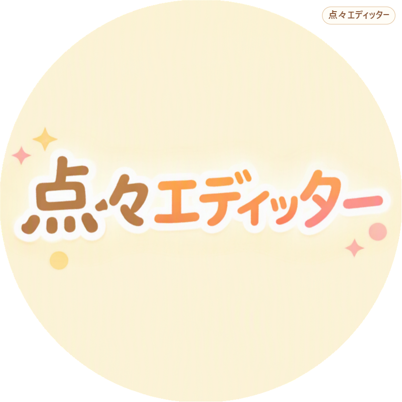
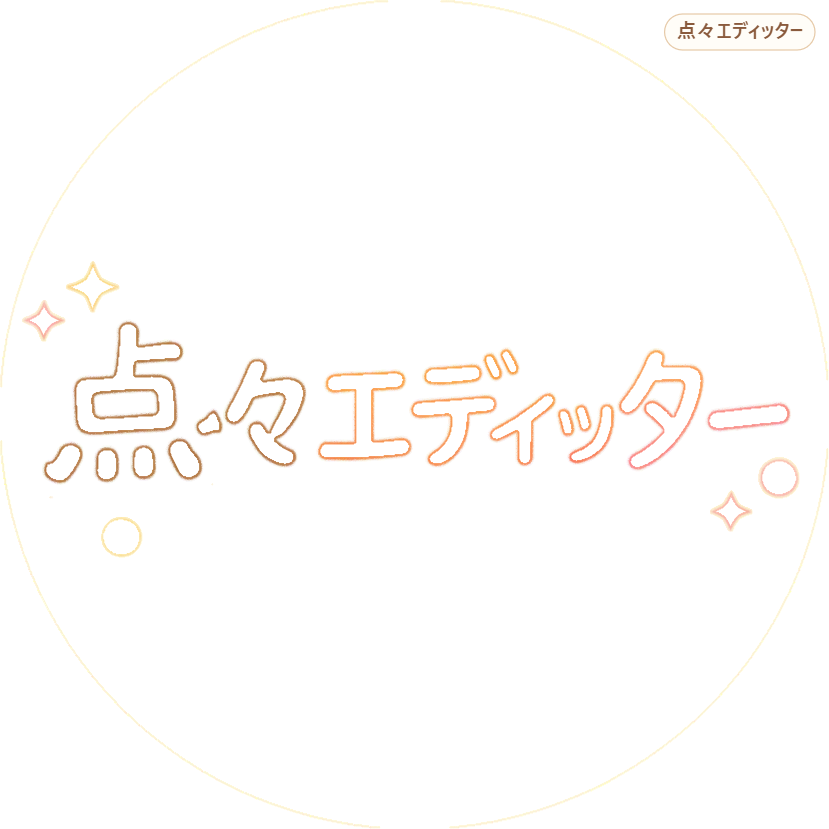

## 点々エディッターについて

****
## 上の画像のようにきれいに高性能に再現することができます。なお輪郭線だと。以下のようになります。

****
> ・著作権表記
> © 2026 suzaki-ao. All rights reserved.
>
>
>・点々エディッターのプログラム・ロゴ・デザインの著作権は suzaki-ao に帰属します。
>
>  
>・プログラムの無断コピー・転載・公開・改変しての再配布・商用利用を禁じます。利用したい場合は suzaki-ao に許可を得てください。
>
>
>・本サービスで生成された画像の著作権は、元画像の権利者、またはユーザー本人に帰属します（利用規約 第2条）。生成物の右上に入る「点々エディッター」の表示は、生成元を示すものです。
>
>
>・アプリ版は Electron（MIT License）および Chromium などのオープンソースソフトウェアを利用しています。各ライセンスはアプリ版の実行時に展開されるフォルダ内（LICENSE.electron.txt / LICENSES.chromium.html）に含まれます。
### © 2026 suzaki-ao. All rights reserved.
